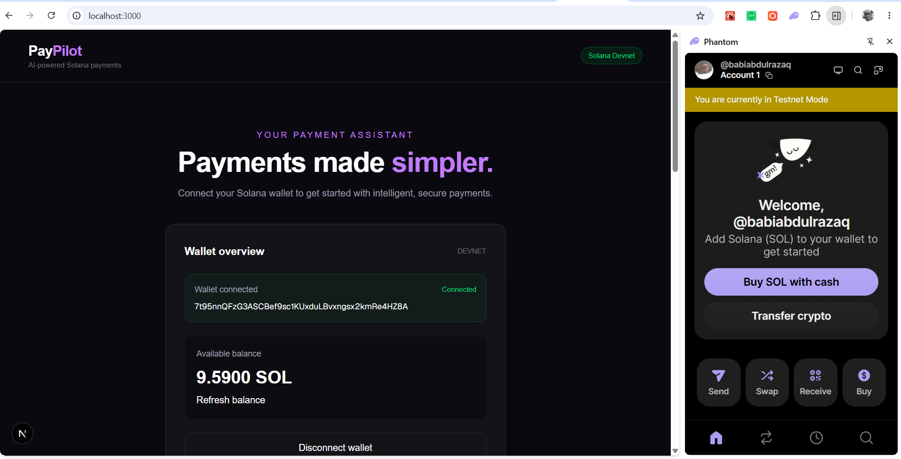
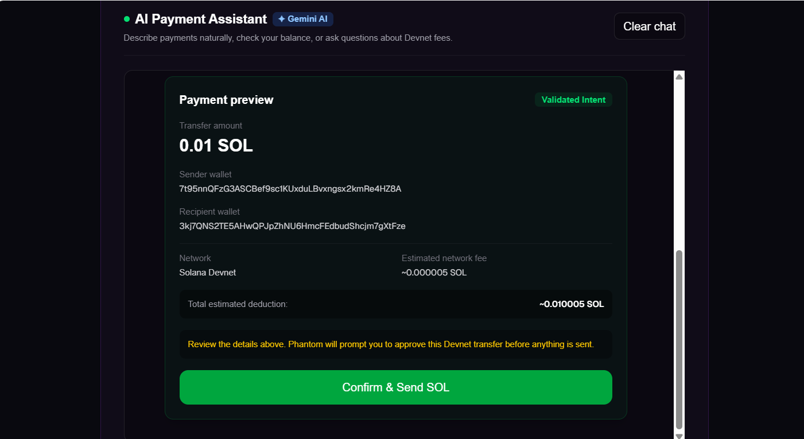
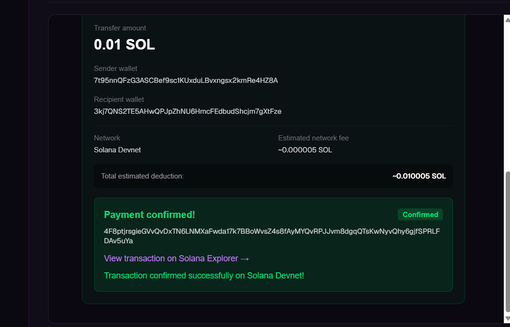
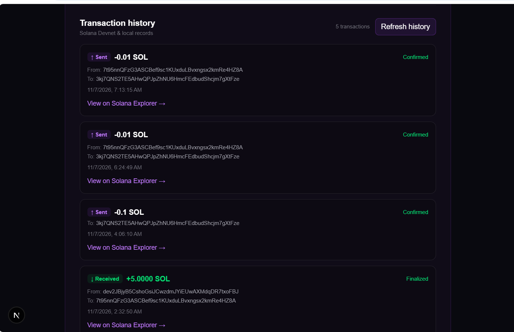
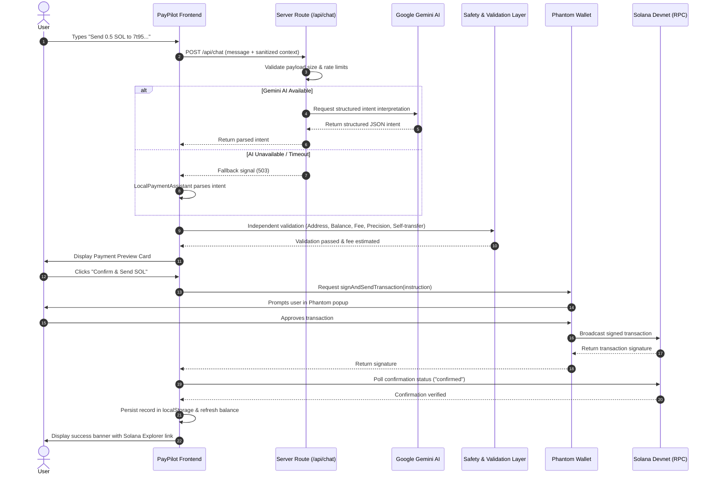
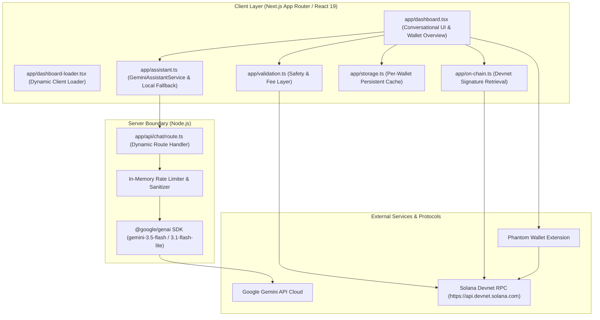

# PayPilot 🚀

> **AI-Powered Solana Payment Assistant**: Conversational, secure, and intent-driven SOL transfers on Solana Devnet.

[](https://explorer.solana.com/?cluster=devnet)
[](https://nextjs.org/)
[](https://ai.google.dev/)
[](https://github.com/solana-labs/solana-web3.js)
[](https://www.typescriptlang.org/)

---

## 📖 Table of Contents

- [Problem Statement & Solution](#-problem-statement--solution)
- [Key Features](#-key-features)
- [Application Screenshots](#-application-screenshots)
- [Payment Lifecycle & Workflow](#-payment-lifecycle--workflow)
- [Architecture & Tech Stack](#-architecture--tech-stack)
- [Security Model & Trust Architecture](#-security-model--trust-architecture)
- [Getting Started & Installation](#-getting-started--installation)
- [Environment Configuration](#-environment-configuration)
- [Testing & Quality Assurance](#-testing--quality-assurance)
- [Live Hackathon Demonstration Guide](#-live-hackathon-demonstration-guide)
- [Devnet Scope & Future Roadmap](#-devnet-scope--future-roadmap)
- [License](#-license)

---

## 🎯 Problem Statement & Solution

### The Problem
Transacting on Web3 remains intimidating and error-prone for everyday users:
- **Cryptic Interfaces**: Users must manually copy 44-character base58 public keys, navigate obscure forms, calculate lamports, and decipher complex network fees.
- **Accidental Loss & Errors**: Simple typos or sending funds to one's own address result in wasted fees or unrecoverable transactions.
- **Disconnected Context**: Users cannot naturally ask questions about recent wallet activity, network fees, or transaction finality in the same interface where they initiate payments.

### The Solution: PayPilot
**PayPilot** introduces a human-centric payments experience for Solana Devnet. Powered by Google's Gemini AI and the modern `@solana/kit` SDK, PayPilot allows users to describe payments in plain English (e.g. *"Send 0.5 SOL to 7t95..."*). PayPilot interprets the intent, estimates network fees, rigorously validates parameters, prepares a structured visual preview, and delegates transaction signing directly to the user's Phantom wallet.

---

## ✨ Key Features

- **Natural Language Payment Interpretation**:
  - Converse naturally using instructions like:
    - *"Send 0.5 SOL to 7t95nnQFzG3ASCBef9sc1KUxduLBvxngsx2kmRe4HZ8A"*
    - *"Transfer 1.25 SOL to this wallet: 3kj7QNS2TE5AHwQPJpZhNU6HmcFEdbudShcjm7gXtFze"*
    - *"Pay 0.1 SOL to 7t95nnQFzG3ASCBef9sc1KUxduLBvxngsx2kmRe4HZ8A"*
  - Intelligently detects missing information (e.g., missing recipient or amount) and asks clarifying questions without guessing.

- **Dual-Engine AI Architecture with Zero-Downtime Fallback**:
  - **Cloud AI (Primary)**: Google Gemini API (`gemini-3.5-flash` with dynamic fallback to `gemini-3.1-flash-lite`) operating server-side to interpret conversational requests and queries.
  - **Deterministic Local Engine (Fallback)**: Built-in local parser (`LocalPaymentAssistant`) that instantly takes over if the external AI service is unconfigured, rate-limited, or experiencing latency spikes.
  - Transparent UI status indicators: `✦ Gemini AI` or `⚡ Local Fallback`.

- **Comprehensive Transaction Safety Layer**:
  - Independent validation of AI output before creating any payment preview.
  - Validates recipient base58 addresses using `@solana/kit` primitives.
  - Blocks self-transfers (preventing accidental loops back to the connected wallet).
  - Enforces 9-decimal precision limits (1 lamport = 0.000000001 SOL).
  - Verifies account balance against transfer amount + estimated network fees.
  - Concurrency lock ref preventing double-submission clicks.

- **Non-Custodial Wallet Integration**:
  - Direct Phantom wallet integration using `@solana/kit-plugin-wallet`.
  - Zero private-key collection: keys remain in the browser extension at all times.
  - The AI model never accesses wallet keys or signs transactions.

- **On-Chain & Persistent Transaction History**:
  - Queries recent signatures and transaction details directly from Solana Devnet via RPC (`getSignaturesForAddress`, `getTransaction`).
  - Distinguishes incoming (`↓ Received`) and outgoing (`↑ Sent`) transfers.
  - Merges on-chain records with validated local browser storage (`localStorage`), scoped per connected wallet.
  - Capped to the 20 latest records, sorted newest first, with one-click refresh and direct Solana Explorer links.

---

## 📸 Application Screenshots

> _Place application screenshots in `public/screenshots/` and update paths below._

| Main Dashboard & Wallet Overview | Conversational Payment Preview |
| :---: | :---: |
|  |  |
| *Phantom Wallet connection, live Devnet balance, and status badges* | *Natural language interpretation, fee estimation, and confirmation card* |

| Live Devnet Explorer Confirmation | Persistent On-Chain Transaction History |
| :---: | :---: |
|  |  |
| *Real-time transaction confirmation and signature verification* | *Deduplicated on-chain Devnet transactions with directional badges* |

---

## 🔄 Payment Lifecycle & Workflow

The diagram below outlines the secure path from a user's conversational prompt to on-chain confirmation:



---

## 🛠️ Architecture & Tech Stack



### Core Technologies
- **Framework**: [Next.js 16.4.5](https://nextjs.org/) (Turbopack, App Router, React 19).
- **Language**: [TypeScript 5](https://www.typescriptlang.org/) (strict mode, zero type errors).
- **Solana Web3 SDK**:
  - `@solana/kit` (`8.6.0`): Next-generation modular Solana SDK for address primitives, lamports, and RPC clients.
  - `@solana/kit-plugin-wallet` & `@solana/react`: Context-aware Phantom wallet connectivity and connection hooks.
  - `@solana-program/system`: Program instructions for native SOL transfers.
- **AI Integration**:
  - `@google/genai` (`^3.0.0`): Official Google Gen AI SDK.
  - Primary model: `gemini-3.5-flash` with structured JSON output and low temperature (`0.2`).
  - Resilient fallback model: `gemini-3.1-flash-lite`.
- **Styling**: [Tailwind CSS 4](https://tailwindcss.com/) with custom responsive dark theme.

---

## 🔒 Security Model & Trust Architecture

PayPilot was built adhering to strict non-custodial and defense-in-depth principles:

1. **Server-Side API Key Isolation**:
   - The Gemini API key is read solely on the server inside [`app/api/chat/route.ts`](file:///c:/Users/USER/Desktop/hacktober/PayPilot/app/api/chat/route.ts).
   - No `NEXT_PUBLIC_` API keys are used.
   - Client-side static bundles (`.next/static/`) are verified to contain zero secrets.

2. **No Private Key Access**:
   - PayPilot **never** asks for, receives, or stores private keys, seed phrases, or recovery mnemonics.
   - User inputs containing seed phrases or private key keywords are intercepted before leaving the server.
   - Transaction signing occurs exclusively inside the isolated Phantom wallet sandbox.

3. **Independent Validation of AI Output**:
   - AI outputs are treated as untrusted user suggestions.
   - Extracted addresses must pass `@solana/kit` base58 decoding.
   - Amount precision is validated strictly up to 9 decimal places.
   - Self-transfers are detected and rejected.
   - Sufficient balance (transfer amount + priority & base fees) is verified against live RPC data before the signing request is created.

4. **Rate Limiting & Abuse Prevention**:
   - Server-side IP rate limiting enforces a maximum of 20 requests per minute per IP.
   - Request payloads are capped at 10 KB, with individual messages restricted to 1,000 characters.

---

## 🚀 Getting Started & Installation

### Prerequisites
- [Node.js](https://nodejs.org/) version 20.x or higher.
- [npm](https://www.npmjs.com/) (bundled with Node.js).
- [Phantom Wallet](https://phantom.app/) browser extension installed.
- Phantom network set to **Solana Devnet** (Settings → Developer Settings → Change Network → Devnet).

### Installation Steps

1. **Clone the repository**:
   ```bash
   git clone https://github.com/your-username/PayPilot.git
   cd PayPilot
   ```

2. **Install dependencies**:
   ```bash
   npm install
   ```

3. **Configure Environment Variables**:
   Copy the example environment file to `.env.local`:
   ```bash
   cp .env.example .env.local
   ```
   Open `.env.local` and add your Google Gemini API key:
   ```env
   GEMINI_API_KEY=your_actual_gemini_api_key_here
   ```
   *(Note: PayPilot works seamlessly with local fallback if no key is supplied).*

4. **Start the development server**:
   ```bash
   npm run dev
   ```

5. **Open the Application**:
   Navigate to [http://localhost:3000](http://localhost:3000) in your web browser.

---

## ⚙️ Environment Configuration

Configuration is managed via environment variables. See [`.env.example`](.env.example):

| Variable | Required | Description |
| :--- | :---: | :--- |
| `GEMINI_API_KEY` | Optional | Server-side Google Gemini API key. If omitted, PayPilot automatically operates in deterministic Local Fallback mode. |

> **Security Note**: `.env.local` is listed in [`.gitignore`](file:///c:/Users/USER/Desktop/hacktober/PayPilot/.gitignore) and will never be committed to source control.

---

## 🧪 Testing & Quality Assurance

PayPilot includes a comprehensive suite of unit, integration, and security tests:

```bash
# Run TypeScript compilation check
npx tsc --noEmit

# Run ESLint validation
npm run lint

# Run all test suites
npm test

# Or run individual test suites
node tests/test_parser.mjs          # Natural language intent parsing
node tests/test_validation.mjs      # Fee estimation, precision & balance protection
node tests/test_storage.mjs         # Per-wallet localStorage persistence & deduplication
node tests/test_assistant.mjs       # Conversational queries & fallback behavior
node tests/test_suggestions.mjs     # Quick-prompt sanitization & self-transfer protection
node tests/test_gemini_integration.mjs # Payload boundaries, rate limiting & error recovery
node tests/audit_gemini_security.mjs   # Security audit & credential isolation checks

# Production build check
npm run build
```

---

## 🎬 Live Hackathon Demonstration Guide

Follow these steps to demonstrate PayPilot during judging:

1. **Connect Wallet**:
   - Ensure the Phantom extension is installed and set to **Devnet**.
   - Click **Connect Phantom**. The wallet overview will display your public address and live Devnet SOL balance.
   - *(Optional: If you need Devnet SOL, request test funds via `solana airdrop 1 <address> --url devnet` or [faucet.solana.com](https://faucet.solana.com)).*

2. **Explore Informational Inquiries**:
   - Click the quick-prompt: **"What's my balance?"** — The assistant reports your live balance.
   - Click: **"What are transaction fees?"** — PayPilot explains the 5,000 lamport base signature fee and compute unit priority fees.
   - Click: **"Show my recent transactions"** — PayPilot summarizes recent Devnet transfers.

3. **Natural Language Transfer Flow**:
   - Type a payment instruction:
     ```text
     Send 0.1 SOL to 7t95nnQFzG3ASCBef9sc1KUxduLBvxngsx2kmRe4HZ8A
     ```
   - Observe the **Payment preview** card appear inside the chat bubble with transfer amount, recipient address, network, and estimated fees.
   - Notice that no funds have moved yet.

4. **Approve via Phantom**:
   - Click the green **"Confirm & Send SOL"** button.
   - The Phantom popup appears displaying the exact transfer parameters.
   - Approve the transaction.

5. **Verification on Solana Explorer**:
   - The UI updates dynamically: `Submitted` → `Confirming on Solana Devnet...` → `Payment confirmed!`.
   - Click **"View transaction on Solana Explorer →"** to inspect the live transaction on Solana Devnet.
   - Observe the balance decrement and the transaction record appear instantly in the **Transaction history** table below.

---

## 🌐 Devnet Scope & Future Roadmap

> [!NOTE]
> PayPilot operates exclusively on **Solana Devnet**. It does not transact with real funds or connect to Solana Mainnet.

### Future Roadmap
- [ ] **SPL Token Transfers**: Natural language payments for Devnet SPL tokens (e.g. USDC devnet mints).
- [ ] **Contact Book & Name Services**: Integration with Solana Name Service (`.sol` domains) to resolve addresses natively.
- [ ] **Multi-Transaction Batching**: Interpret multi-recipient payroll instructions (e.g., *"Send 0.2 SOL to Alice and 0.3 SOL to Bob"*).
- [ ] **Distributed Cluster Rate Limiting**: Backing the server rate limiter with Redis/Upstash for multi-region serverless scaling.
- [ ] **Recurring Streaming Payments**: Integration with streaming protocols (e.g. Zebec/Superfluid) for automated time-based payments.

---

## 📄 License

This project is open-source under the [MIT License](LICENSE). Built with ❤️ for the Solana Community.
